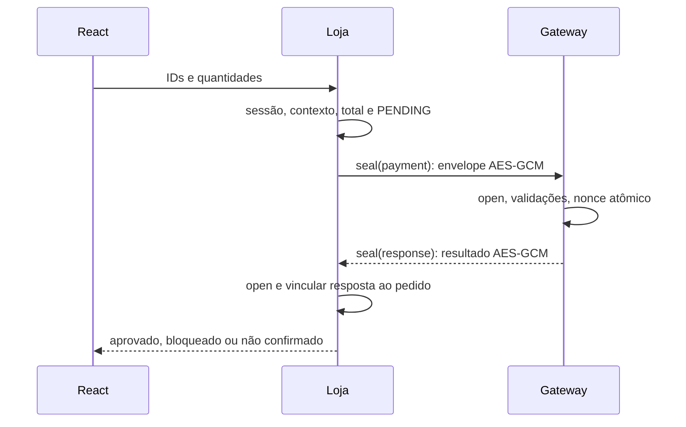

# Como funciona a Loja Segura

Este guia acompanha os fluxos de autenticação e compra no código.
O mapa de arquivos está em [arquitetura.md](arquitetura.md) e a descrição técnica
em [relatorio.md](relatorio.md).

## Onde começar

O [mapa dos módulos](arquitetura.md) indica as responsabilidades. Para acompanhar
a execução, abra `server/modules/auth/auth.routes.ts`,
`server/modules/orders/orders.service.ts`, `server/modules/payments/payment.service.ts`
e `gateway/modules/payments/payment.service.ts`. Rotas tratam HTTP, serviços
implementam regras e repositórios fazem SQL. Cada processo tem seu banco/cofre.

## Cadastro, senha, TOTP e sessão

1. `CredentialsForm.submit` chama `register` ou `login` em `modules/auth/api.ts`.
2. `auth.routes.ts` valida os tipos/tamanhos e limita tentativas por conexão/conta.
3. `registerUser` chama `validateRegistration`, `createAccount` e `prepareChallenge`.
   `createAccount` gera ID/segredo TOTP, chama `hashPassword` e `encryptTotp`, e
   grava verificador/salt e semente cifrada pelo repositório.
4. `loginWithPassword` chama `verifyPassword`. Só depois decifra a semente com
   `readTotpSecret`/`decryptTotp` e cria `newChallenge`, válido por cinco minutos e ligado ao IP.
   QR/chave manual só são retornados enquanto a habilitação estiver pendente.
5. `TotpForm.submit` envia código e desafio. A rota obtém `requestLocation`;
   `verifySecondFactor` chama `takeAttempt`, `verifyTotp`, `decide` e `useTotpCounter`.
   O TOTP aceita o período atual e ±1; o consumo do contador é atômico.
6. Só após essas verificações `setSession` grava o hash SHA-256 de um token
   aleatório e envia cookie HttpOnly/SameSite=Strict, válido por 12 horas.
   Os desafios da conta são descartados. Senha correta sozinha não cria sessão.
7. `readSession` exige sessão vigente e 2FA persistida. `revokeSession` faz logout.
   As duas funções usam `readSessionToken` para ler e validar o cookie.

```mermaid
sequenceDiagram
  React->>Loja: nome/email/senha ou email/senha
  Loja->>SQLite: Scrypt e semente cifrada
  Loja-->>React: desafio; QR só na habilitação
  React->>Loja: desafio + TOTP
  Loja->>DB5: IP observado (ou cenário demo)
  Loja->>SQLite: consumir contador e criar sessão
  Loja-->>React: cookie + usuário
```

## Compra e resposta autenticada

1. O React envia **somente IDs e quantidades** a `/api/checkout`.
2. `checkout` recebe a sessão validada pela rota. `validateCheckoutContext` exige
   contexto permitido e o mesmo IP do login; `readOrderItems` chama `orderItems`.
   `totalCents` calcula o total a partir dos preços do catálogo.
3. `preparePayment` inclui pedido, usuário, itens, reais/centavos, BRL, nonce,
   timestamp, localização e autorização construída a partir da sessão do servidor.
   `insertPendingOrder` registra `PENDING` antes da comunicação.
4. `pay` chama `seal` e `sendToGateway`. O envelope contém apenas versão, salt,
   ciphertext e tag. Chave e IV não são transmitidos.
5. `processPayment` chama `open`, depois `validatePayment`, depois `acceptOnce`.
   A reserva de nonce e a gravação do pagamento são uma transação síncrona.
6. O gateway cifra o resultado com domínio `response`. `pay` exige que a resposta
   tenha sido autenticada por `open`; nem um bloqueio em claro confirma um pedido.
   A loja também chama
   `verifyGatewayResponse`: pedido, nonce, timestamp e HTTP precisam corresponder.
7. `payAndConfirmOrder` chama `pay` e `confirmOrder` para registrar aprovação/bloqueio.
   O React mostra o resultado e o
   histórico. Falha de comunicação vira `ERROR`/não confirmado, nunca aprovação.

No histórico, `order_id`, `user_id`, `items` e `total` correspondem ao exemplo de
pedido do PDF; `id` e `total_cents` continuam disponíveis. Reais são uma
representação de saída; o cálculo e armazenamento usam centavos inteiros.



O gateway confia na loja como emissora autenticada da autorização: confere
estado/tempos da sessão e coerência do contador TOTP. Não recebe a semente do
usuário nem recalcula seu TOTP. Uma loja comprometida está fora dessa garantia.

Em `gateway/modules/payments/payment.validation.ts`, comece por `validatePayment`.
Ela chama, em ordem, `validateMessage`, `validateAuthorization`, `validateOrder`
e `validateContext`. Cada etapa retorna `null` quando passa ou o motivo do bloqueio.
Uma falha interrompe a sequência; `acceptOnce` só é chamado após todas passarem.
As janelas de pagamento, sessão e TOTP estão nomeadas em `shared/protocol/limits.ts`.

## Conceitos que não devem ser confundidos

| Conceito | Significado nesta aplicação |
|---|---|
| Scrypt | KDF com custo de memória: N=16384, r=8, p=1; verifica senha e protege a semente TOTP. Não é cifra. |
| PBKDF2 | KDF iterativa: HMAC-SHA512, 210.000 passos; deriva 44 bytes para cofres e mensagens. |
| AES-GCM | Cifra autenticada: protege conteúdo, integridade e autenticidade; tag de 16 bytes. Não garante frescor sozinha. |
| Salt | Valor público aleatório: 16 bytes em credenciais, 32 em envelopes; muda o material derivado. |
| IV | 12 bytes derivados pela KDF junto com a chave AES de 32 bytes; participa da cifra. Não fica fixo/global. |
| Nonce | ID aleatório da transação (32 bytes em hex); persistido no gateway para impedir repetição. É diferente do IV. |
| Timestamp | Instante em segundos; janela de ±120 s para mensagens, complementar ao nonce. |
| TOTP | Código de seis dígitos: HMAC-SHA1, contador de períodos de 30 s e truncamento dinâmico. É o segundo fator. |
| IP2Location | Consulta local de IP à DB5: país/região/cidade/coordenadas aproximadas, sem GPS; DB5 não tem ASN/organização. |

Na seção 12 do enunciado, chave/IV devem ser derivados e não fixados no código.
Cada processo abre **seu cofre cifrado** com senha recebida por stdin. `material`
usa segredo + salt novo + domínio; `seal`/`open` mantêm chave/IV apenas durante a
operação e zeram o buffer derivado. `open` só usa plaintext depois de verificar a
tag em `decipher.final()`. O segredo de derivação precisa estar na memória do
processo durante sua operação; não é enviado ao React.

O setup e o launcher usam `verifyVaultPair` para conferir se os dois cofres
contêm o mesmo segredo. Essa função só verifica o provisionamento e limpa os
buffers ao terminar; cada serviço continua abrindo seu próprio cofre.

## Os quatro ataques

| Ação real | Quem rejeita/ignora | Código para abrir |
|---|---|---|
| Replay: reenviar exatamente o envelope aprovado. | `acceptOnce` retorna `INVALID_NONCE`; após 120 s, `validatePayment` pode bloquear antes por `INVALID_TIMESTAMP`. | `security-demo.service.ts: runAttack`; `gateway/.../nonce.repository.ts: acceptOnce`. |
| Valor: alterar três bytes do ciphertext para `100` → `1e3` (=1000), conservando tag/salt. | `open` falha na autenticação; `processPayment` responde 400 `INVALID_AUTH_TAG`. | `security-demo.service.ts: tamperAmount`; `shared/protocol/encryption.ts: open`. |
| TOTP: senha válida cria desafio; enviar código incorreto de seis dígitos. | `verifyTotp`/`verifySecondFactor` rejeitam com 401 sem criar sessão. | `src/modules/security-demo/api.ts: testTotpRequest`; `server/modules/auth/second-factor.service.ts`. |
| Localização: enviar IP/país/cidade falsos, inclusive header forjado no script. | `requestLocation` ignora declaração e usa socket/DB5; o gateway também reconsulta a DB5. | `context.routes.ts`; `context.service.ts: requestLocation`; `payment.validation.ts`. |

No modo normal, o IP vem de `req.socket.remoteAddress`, com `trust proxy=false`.
No demo, `150.162.60.21` é **cenário configurado no servidor**, não o IP real do
usuário. O proxy Vite não comprova a origem do navegador; para execução compilada,
Express serve frontend e API na mesma origem. Loopback não tem país público.

`decide` bloqueia país desconhecido/mudança de país; região diferente no mesmo
país é permitida com motivo. O contexto apoia autorização; não substitui TOTP.
Para ensaiar esses fluxos, siga [apresentacao.md](apresentacao.md).
